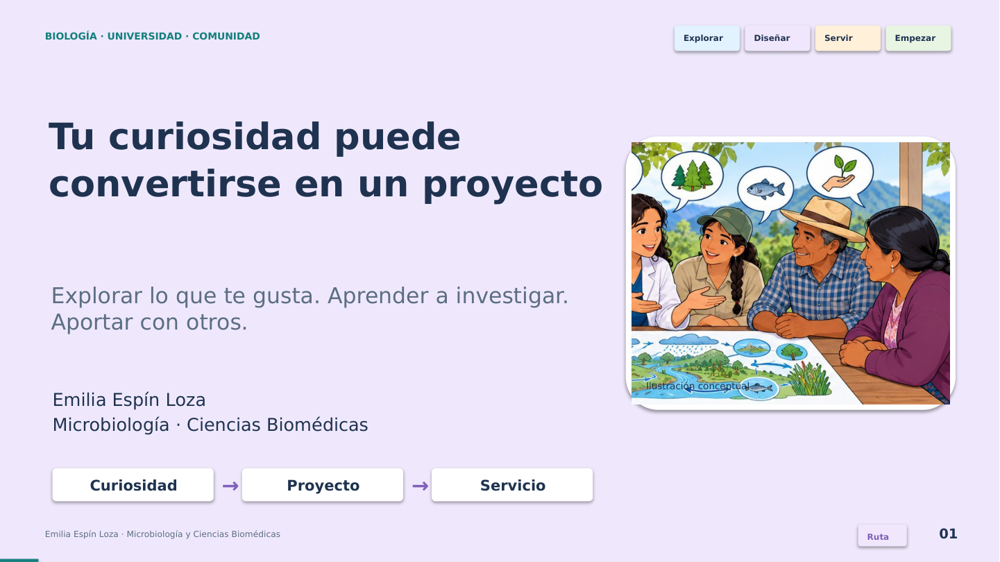

# Materiales de docencia · Emilia Espín Loza

## Laboratorio openLCA · 50 minutos · Windows

Práctica sobre bebida de avena y leche, basada en el tema del caso oficial del manual de openLCA 2. Adaptación gratuita con una minibase y **datos simulados**, para aprender a importar, calcular y comprobar resultados.

- [Guía de laboratorio en Word](https://github.com/espinemilia02-design/Clases2026/raw/refs/heads/main/clase_openlca_50min/Guia_laboratorio_openLCA_50min.docx)
- [Diapositivas en PowerPoint](https://github.com/espinemilia02-design/Clases2026/raw/refs/heads/main/clase_openlca_50min/Diapositivas_openLCA_50min.pptx)
- [Paquete completo: Word, diapositivas interactivas, minibase, caso y controles](https://github.com/espinemilia02-design/Clases2026/raw/refs/heads/main/clase_openlca_50min/Paquete_openLCA_50min.zip)
- [Instrucciones y archivos del laboratorio](clase_openlca_50min/README.md)

Instalación y descargas como preparación previa; 50 minutos de práctica. Se verificaron importación, estructura y cálculos con el motor real openLCA 2.6.2. El inventario ficticio no sirve para comparar productos reales.

---

## Biología: de la curiosidad al servicio

Clase participativa de **40 minutos** para estudiantes universitarios. El recorrido conecta intereses, oportunidades en la universidad, formulación de proyectos y servicio comunitario. Incluye dos experiencias de Emilia Espín Loza como ejemplos.

## Descargar los materiales

- [PowerPoint actualizado (40 minutos)](https://github.com/espinemilia02-design/Clases2026/raw/refs/heads/main/Emilia_Espin_Perfil_docente.pptx)
- [Paquete completo: PowerPoint, PDF, HTML, guion y ficha](https://github.com/espinemilia02-design/Clases2026/raw/refs/heads/main/clase_40min/Clase_Biologia_Proyectos_Comunidad_40min.zip)
- [Diapositivas en PDF](https://github.com/espinemilia02-design/Clases2026/raw/refs/heads/main/clase_40min/Biologia_Proyectos_Comunidad_40min.pdf)
- [Guion para facilitar la clase](https://github.com/espinemilia02-design/Clases2026/raw/refs/heads/main/clase_40min/Guion_40min_Emilia_Espin.pdf)
- [Ficha de proyecto de una página](https://github.com/espinemilia02-design/Clases2026/raw/refs/heads/main/clase_40min/Ficha_proyecto_Biologia_1_pagina.pdf)

Si GitHub solicita iniciar sesión, utiliza una cuenta con acceso al repositorio. También puedes abrir un archivo y usar su botón de descarga.

## Cómo está organizada

- 26 diapositivas principales y 6 anexos de consulta.
- Intereses, confianza para empezar y personas o espacios que explorar en la universidad.
- Preguntas investigables, selección de métodos y lectura crítica de resultados.
- Colaboración comunitaria desde la pregunta hasta la devolución.
- Una carrera que integra sustento, aprendizaje, comunidad y ambiente.
- Taller de proyecto y presentación breve en parejas.

## Uso en clase

En PowerPoint, abre el modo Presentación para usar los botones y las cuatro animaciones. Las notas contienen el guion y los tiempos. Los gráficos de diversidad son editables.

Los seis espacios para fotos están en las **diapositivas 9 y 17**.

La versión HTML viene en el paquete. Descárgalo, descomprímelo y abre `Biologia_Proyectos_Comunidad_40min.html` en un navegador de escritorio. Funciona sin internet e incluye preguntas, campos para escribir y carga de fotos. Usa **Guardar copia** para conservar las fotos y los campos completados en un nuevo HTML. Atajos: flechas para navegar, **N** para notas y **F** para pantalla completa.

La ficha de proyecto se puede imprimir o completar en un lector de PDF compatible con formularios.

## Referencias

Los métodos y resultados conservan como referencias `DS_Agua_Loja_2025.pptx`, `ECCA_EE_CY_vc1 (1).pptx` y el CV aportado. Los casos didácticos y el taller se identifican como propuestas para la clase. Las ilustraciones científicas son originales y conceptuales.

