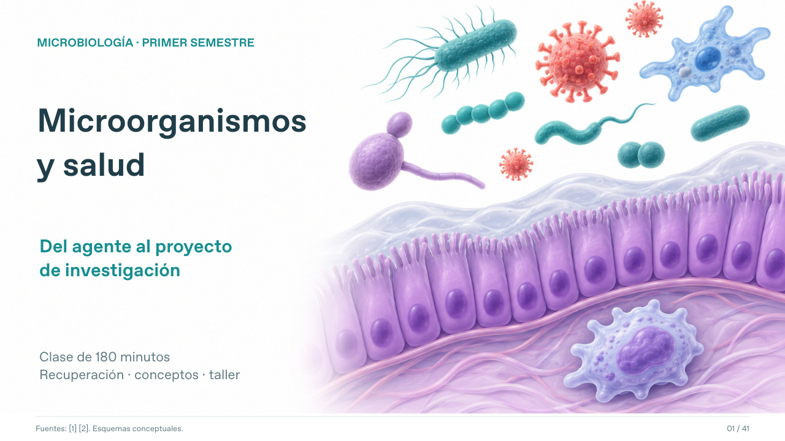

# Microorganismos y salud: del agente al proyecto

Clase de **180 minutos**, para primer semestre de Microbiología, Biología y Ciencias Biomédicas. **35 diapositivas para clase + 6 de bibliografía.**

- [Descargar PowerPoint editable](https://github.com/espinemilia02-design/Clases2026/raw/refs/heads/main/agentes_importancia_medica_180min/Agentes_de_importancia_medica_180min.pptx)
- [Ver PDF](Agentes_de_importancia_medica_180min.pdf)
- [Guía docente, respuestas y resúmenes de artículos](Guia_docente_Agentes_importancia_medica.md)
- [Ficha imprimible: recuperación, taller, proyecto y rúbrica](Ficha_recuperacion_y_taller.pdf)

## Distribución

| Bloque | Duración |
|---|---|
| Recuperación de conocimientos | 35 min |
| Descanso | 15 min |
| Agentes de importancia médica | 60 min |
| Proyectos de salud y taller | 60 min |
| Cierre | 10 min |

Incluye microbiota, colonización, infección y enfermedad; patogenicidad, virulencia y oportunismo; transmisión, prevención y tipos de evidencia. El taller «Conozcamos un agente patógeno» prepara una exposición de 8 minutos y 2 de preguntas, basada en un estudio de Ecuador.

El bloque de proyectos adapta el material docente **Emilia_Espin_intro.pptx**, de Emilia Espín Loza: pasar de una preocupación a una pregunta, elegir una evidencia y prever una devolución útil. La visita al CISeAL corresponde a otra clase, en laboratorio.

Fuentes consultadas al 9 de noviembre de 2026. Se combinan fundamentos abiertos con artículos y documentos oficiales de 2019–2026. Las ilustraciones originales con asistencia de IA son esquemas conceptuales; no son micrografías ni tienen autoría o validación de BioRender. Tablas, texto y gráfica editables. Bibliografía completa en el PowerPoint y en la guía.
