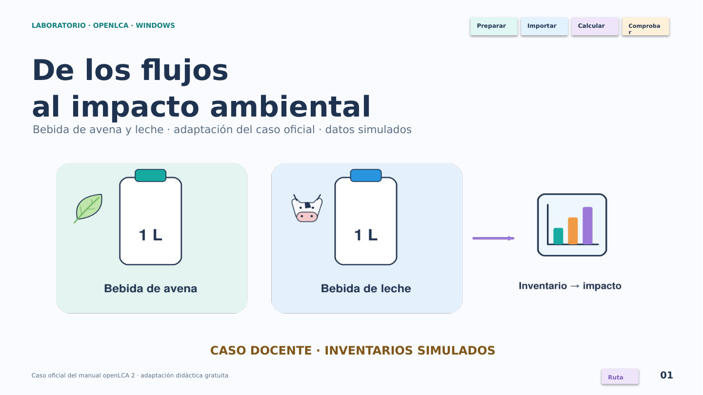

# Laboratorio openLCA · 50 minutos · Windows

**Bebida de avena y leche:** adaptación didáctica gratuita del tema del [caso oficial del manual de openLCA 2](https://github.com/GreenDelta/openLCA2-manual/blob/ae0588e4c013cca18ec1bf136cc144457d032541/src/conceptual_guideline.md).

Los inventarios son **simulados** y el alcance es limitado para poder comprobar las cuentas en clase. No son AGRIBALYSE ni ecoinvent y no se deben usar para evaluar alimentos reales.

## Descargar

- [Guía de laboratorio en Word](https://github.com/espinemilia02-design/Clases2026/raw/refs/heads/main/clase_openlca_50min/Guia_laboratorio_openLCA_50min.docx)
- [Diapositivas editables en PowerPoint](https://github.com/espinemilia02-design/Clases2026/raw/refs/heads/main/clase_openlca_50min/Diapositivas_openLCA_50min.pptx)
- [Paquete completo](https://github.com/espinemilia02-design/Clases2026/raw/refs/heads/main/clase_openlca_50min/Paquete_openLCA_50min.zip)
- [Guía en PDF](https://github.com/espinemilia02-design/Clases2026/raw/refs/heads/main/clase_openlca_50min/Guia_laboratorio_openLCA_50min.pdf)
- [Diapositivas en PDF](https://github.com/espinemilia02-design/Clases2026/raw/refs/heads/main/clase_openlca_50min/Diapositivas_openLCA_50min.pdf)

El paquete incluye la versión HTML interactiva, dos modelos JSON-LD, inventarios, resultados esperados y controles de integridad.

## Preparar y ejecutar

1. Antes de la clase, [descarga openLCA para Windows desde su web oficial](https://www.openlca.org/download/), extrae el ZIP del programa y ejecuta `openLCA.exe`. Registra su versión.
2. Descarga y extrae el ZIP exterior del paquete del curso.
3. Crea una base nueva **Empty database**, por ejemplo `LAB_Bebidas_Grupo01`.
4. En esa base activa importa **sin extraerlos**: primero [01_BASE_DOCENTE_JSONLD.zip](https://github.com/espinemilia02-design/Clases2026/raw/refs/heads/main/clase_openlca_50min/01_BASE_DOCENTE_JSONLD.zip) y luego [02_CASO_BEBIDAS_JSONLD.zip](https://github.com/espinemilia02-design/Clases2026/raw/refs/heads/main/clase_openlca_50min/02_CASO_BEBIDAS_JSONLD.zip).
5. Usa el importador **JSON package (*.zip) / JSON-LD**, no el de `.zolca`.
6. Control final: **6 procesos, 10 flujos, 2 sistemas y 1 método**.
7. Calcula `DOC_PS_AVENA_1L` y `DOC_PS_LECHE_1L` a **1 L** con `DOC_GWP100_AR5_3gases`.

La instalación y las descargas son preparación previa. Los 50 minutos se dedican al ejercicio, la revisión y la interpretación.

## Material interactivo

Abre `Diapositivas_openLCA_50min_interactivas.html` en un navegador de escritorio después de extraer el paquete. Funciona sin internet salvo enlaces externos. Tiene preguntas con retroalimentación, cuenta manual, cambio de 1 a 2 L y sensibilidad del CH4. Las calculadoras son apoyos didácticos y no sustituyen ni modifican tu base de openLCA. El propio HTML permite descargar los dos modelos.

En PowerPoint usa modo Presentación para botones, respuestas y animación. Las 22 diapositivas principales tienen notas y tiempos; hay 8 anexos de consulta.

## Comprobar los datos

- [Inventario por proceso](https://github.com/espinemilia02-design/Clases2026/raw/refs/heads/main/clase_openlca_50min/Inventario_docente_por_proceso.csv)
- [Resultados esperados](https://github.com/espinemilia02-design/Clases2026/raw/refs/heads/main/clase_openlca_50min/Resultados_esperados_docentes.csv)
- [SHA-256 de los modelos](https://github.com/espinemilia02-design/Clases2026/raw/refs/heads/main/clase_openlca_50min/SHA256_MODELOS.txt)
- [Informe de verificación del motor](https://github.com/espinemilia02-design/Clases2026/raw/refs/heads/main/clase_openlca_50min/Verificacion_motor_openLCA_2_6_2.json)

Se importaron los dos JSON-LD y se ejecutó el validador y los cálculos con el motor real **olca-core 2.6.2**. Pasaron: inventario, GWP100, escalado a 2 L, equivalencia 0.05 kg = 50 g, sensibilidad del CH4 y restauración. El validador devolvió **0 errores y 0 avisos**. No se ejecutó la interfaz de Windows en este entorno; los menús se contrastaron con el manual oficial.

El método docente caracteriza tres gases. Agua sin factor no significa impacto cero. La unidad de 1 L tampoco implica equivalencia nutricional.

