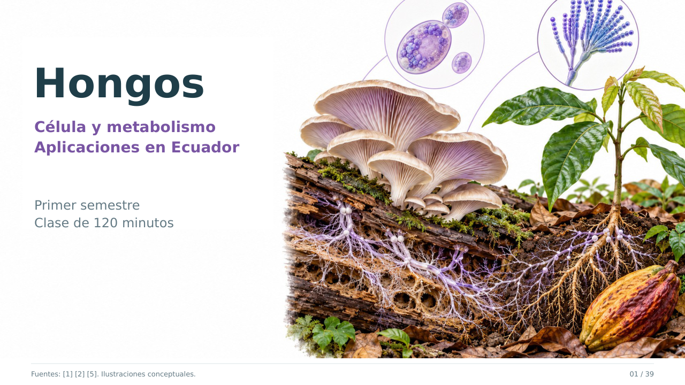

# Hongos: célula, metabolismo y aplicaciones en Ecuador

Clase visual de **120 minutos** para primer semestre de Microbiología, Biología y Ciencias Biomédicas.

## Abrir o descargar

- [PowerPoint editable](https://raw.githubusercontent.com/espinemilia02-design/Clases2026/main/hongos_ecuador_120min/Hongos_Ecuador_120min.pptx)
- [Ver presentación en PDF](https://github.com/espinemilia02-design/Clases2026/blob/main/hongos_ecuador_120min/Hongos_Ecuador_120min.pdf)
- [Descargar PDF](https://raw.githubusercontent.com/espinemilia02-design/Clases2026/main/hongos_ecuador_120min/Hongos_Ecuador_120min.pdf)
- [Ficha para la actividad de 30 minutos — tres casos](https://raw.githubusercontent.com/espinemilia02-design/Clases2026/main/hongos_ecuador_120min/Ficha_actividad_Hongos_30min.pdf)
- [Guía docente: tiempos, explicaciones, respuestas y bibliografía](Guia_docente_Hongos_120min.md)

## Contenido y tiempo

La presentación contiene **39 diapositivas: 34 para clase y cinco de bibliografía**. Las notas del PowerPoint incluyen explicaciones, precisiones científicas y referencias por diapositiva.

- Minutos **0–86**: célula, envoltura, hifas y micelio, formas de crecimiento, estructuras macro y microscópicas, clasificación, identificación, reproducción, metabolismo, nutrición y aplicaciones.
- Minutos **86–116**: actividad en equipos sobre tres artículos de Ecuador.
- Minutos **116–120**: cierre individual.

La clasificación relaciona los filos con las formas macro y microscópicas y utiliza el marco de Wijayawardene et al. (2024). Macrohongo, moho y levadura no son rangos taxonómicos.

## Cinco estudios de Ecuador

| Organismo o sistema | Pregunta y alcance | Publicación |
|---|---|---|
| Pleurotus ostreatus HUTPL-329 | Cultivo en residuos agrícolas y tiempos de fructificación en el sur de Ecuador. | [Cruz et al., 2020](https://doi.org/10.18272/aci.v12i2.1806) |
| Levaduras de cacao y bacterias | Consorcio iniciador con Torulaspora delbrueckii y Hanseniaspora uvarum. | [Falconí et al., 2023](https://doi.org/10.3390/agronomy13102572) |
| Trichoderma spp. | Extractos con actividad frente a patógenos del cacao en laboratorio. | [Chóez-Guaranda et al., 2023](https://doi.org/10.3390/molecules28073208) |
| Gloeocystidiellum lojanense | Especie nueva, evidencia morfológica y molecular y actividad frente a determinadas cepas de E. coli. | [Jaramillo-Riofrío et al., 2023](https://doi.org/10.3390/jof9010054) |
| Rizósfera de Inga en Tiputini | Comunidades fúngicas en terra firme y várzea; estudio de asociaciones. | [Arévalo-Granda et al., 2023](https://doi.org/10.3389/ffunb.2023.1086194) |

## Ejercicio de 30 minutos

La ficha contiene una página para cada caso: **A. Trichoderma, B. Fermentación de cacao, C. Especie nueva y bioactividad**. Cada equipo relaciona estructura, fisiología y resultado medido, reconoce el límite de la evidencia y propone una comparación adicional. La guía incluye respuestas orientativas y una rúbrica de ocho puntos.

## Figuras y fuentes

Las ilustraciones son esquemas originales generados con IA y revisados para docencia; no son micrografías ni fotografías de especímenes o resultados experimentales. Los rótulos, los cuatro cuadros comparativos y la gráfica son editables en PowerPoint. La gráfica de fructificación utiliza los valores reportados por Cruz et al. (2020), sin barras de error inventadas.

La bibliografía reúne 13 fuentes. Los cinco estudios de Ecuador son publicaciones primarias de 2020–2023; la clasificación se actualiza con la revisión de 2024. El libro de Dube (2013), compartido por la docente, se utiliza como referencia histórica de fundamentos. El otro enlace de Google Books no pudo consultarse de forma verificable y no se le atribuyen afirmaciones. La guía detalla las fuentes y el alcance de consulta.

Preparación y revisión: **27 de octubre de 2026**.
