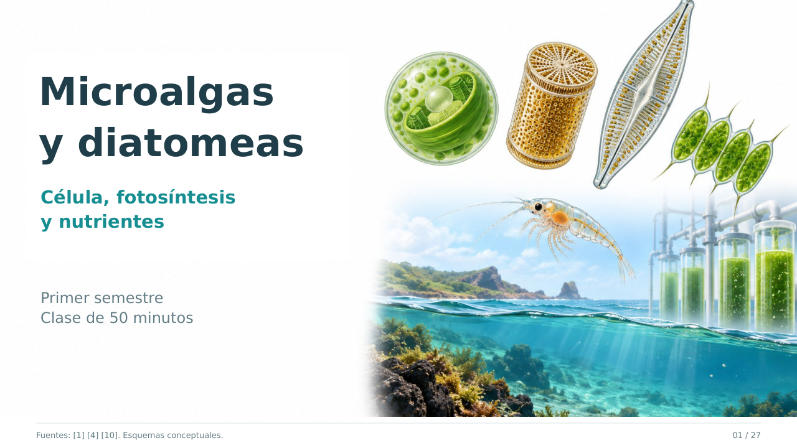

# Microalgas y diatomeas: célula, fotosíntesis y nutrientes

Clase visual de **50 minutos** para primer semestre de Microbiología, Biología y Ciencias Biomédicas.

## Archivos

- [Descargar PowerPoint editable](https://raw.githubusercontent.com/espinemilia02-design/Clases2026/main/microalgas_diatomeas_ecuador_50min/Microalgas_y_diatomeas_Ecuador_50min.pptx)
- [Ver presentación en PDF](https://github.com/espinemilia02-design/Clases2026/blob/main/microalgas_diatomeas_ecuador_50min/Microalgas_y_diatomeas_Ecuador_50min.pdf)
- [Descargar PDF](https://raw.githubusercontent.com/espinemilia02-design/Clases2026/main/microalgas_diatomeas_ecuador_50min/Microalgas_y_diatomeas_Ecuador_50min.pdf)
- [Ficha de actividad de 10 minutos](https://raw.githubusercontent.com/espinemilia02-design/Clases2026/main/microalgas_diatomeas_ecuador_50min/Ficha_actividad_Microalgas_10min.pdf)
- [Guía docente, preguntas, respuestas y bibliografía](Guia_docente_Microalgas_50min.md)

## Contenido

**27 diapositivas: 21 para clase y seis de bibliografía.** El PowerPoint contiene notas con tiempos y explicaciones para recorrer las figuras.

La presentación incluye:

- Organización celular de microalgas verdes y diatomeas.
- Composición, pigmentos, reservas, frústulo y caracteres de identificación.
- Clasificación de representantes en distintos linajes y jerarquía de Chlorella vulgaris.
- Reacciones luminosas, ciclo de Calvin-Benson, respiración.
- Asimilación de nitrógeno y fósforo, y silicio en diatomeas.
- Producción primaria, redes alimentarias, destino del carbono y calidad del agua.
- Cultivo, biomasa y aplicaciones investigadas en Ecuador.

## Tiempo y actividad

| Minutos | Trabajo |
|---|---|
| 0–39 | Explicación visual, comparación de estructuras y estudios de Ecuador |
| 39–49 | Actividad en equipos con un artículo por equipo |
| 49–50 | Cierre individual |

La ficha de tres páginas desarrolla los casos A, B y C. Cada equipo elige dos preguntas del caso. Los equipos relacionan estructura, metabolismo y resultado medido, reconocen el alcance de una conclusión y proponen una comparación adicional. La guía incluye orientaciones de respuesta y una rúbrica.

## Estudios de Ecuador

| Estudio | Qué se evaluó | Aplicación |
|---|---|---|
| [Galarza et al., 2026](https://doi.org/10.3390/phycology6020060) | Aislamiento, identidad y composición de cepas de Santa Elena, incluidas Conticribra weissflogii y Halamphora coffeiformis | Potencial nutricional para acuicultura |
| [Flores-Zambrano et al., 2025](https://doi.org/10.1016/j.btre.2025.e00883) | Crecimiento y remoción de nitrógeno por aislamientos de efluentes porcinos | Selección de cepas para tratamiento |
| [López-Patiño et al., 2024](https://doi.org/10.3389/fbioe.2024.1338547) | Consorcios de origen amazónico en agua doméstica | Tratamiento con comunidades microbianas |
| [Álvarez-Montero et al., 2025](https://doi.org/10.3389/fpls.2025.1568057) | Cultivo de Scenedesmus sp. en efluente lácteo y tratamientos en frijol | Producción de biomasa y uso agrícola |

Los resultados conservan sus condiciones y límites. El perfil nutricional de un aislamiento no sustituye un ensayo de alimentación, y la disminución de nutrientes en agua requiere medidas adicionales para demostrar su recuperación en biomasa.

## Figuras y bibliografía

Las figuras son **esquemas científicos originales generados con IA y revisados para docencia**. No son fotografías de las cepas, micrografías ni resultados experimentales. No comparten escala. Los rótulos, cuatro cuadros y una gráfica permanecen editables en PowerPoint.

La gráfica redibuja valores de proteína en masa seca publicados por Galarza et al. (2026), sin añadir barras de error ni afirmar diferencias significativas. La guía reúne **16 fuentes** y precisiones sobre taxonomía, metabolismo y lectura de resultados.

Preparación y consulta bibliográfica: **28 de octubre de 2026**.

