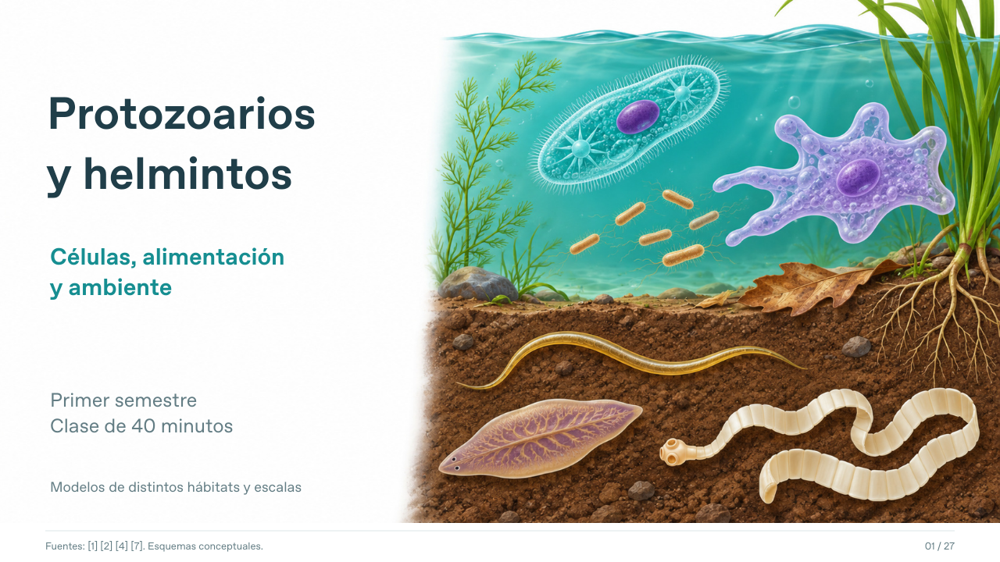

# Protozoarios y helmintos: células, alimentación y ambiente

Presentación para primer semestre de Microbiología, Biología y Ciencias Biomédicas. **40 minutos en total, incluida una actividad de 6 minutos.**

- [Descargar PowerPoint editable](https://github.com/espinemilia02-design/Clases2026/raw/refs/heads/main/protozoarios_helmintos_ecuador_40min/Protozoarios_y_helmintos_Ecuador_40min.pptx)
- [Ver presentación PDF](Protozoarios_y_helmintos_Ecuador_40min.pdf)
- [Guía docente y resúmenes de artículos](Guia_docente_Protozoarios_helmintos_40min.md)
- [Ficha de actividad: tres casos, 6 minutos](Ficha_actividad_Protozoarios_6min.pdf)

20 diapositivas de clase y 7 de bibliografía. Incluye clasificación taxonómica, célula y composición, fagocitosis, estructuras de movimiento, organización de nematodos y platelmintos, metabolismo, reproducción, ciclo de Ascaris y funciones ambientales. Cuatro tablas comparativas y una gráfica de prevalencia son editables. Las ilustraciones están integradas como imágenes.

Las aplicaciones se apoyan en cinco publicaciones sobre Ecuador de 2023–2026: comunidades de protistas en bosque montano, calidad de agua de Cuenca, vigilancia en gestantes, interacción hongo–nematodo y contaminación de productos agrícolas. La guía explica métodos, resultados y límites de cada trabajo. Las referencias históricas aportadas por la docente se distinguen de la clasificación y la evidencia recientes.

En la actividad, cada equipo recibe una página y elige dos preguntas de su caso. Se trabaja 1 minuto de lectura, 3 de discusión y 2 de puesta en común. La guía contiene respuestas orientadoras.

Figuras conceptuales originales generadas con asistencia de IA, de estilo científico y sin escala común. No son micrografías ni imágenes experimentales de los artículos. La portada reúne modelos de distintos hábitats. La guía incluye detalles de fuentes y alcance. Bibliografía consultada el 2 de noviembre de 2026.
