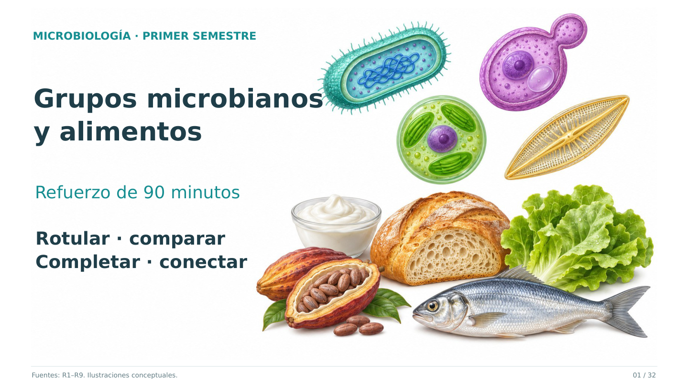

# Refuerzo: grupos microbianos y alimentos

Clase participativa de **90 minutos** para primer semestre de Microbiología, Biología y Ciencias Biomédicas. Mantiene el estilo visual de la colección: fondo blanco, ilustraciones científicas y colores por grupo.

## Abrir o descargar

- [PowerPoint con textos, flechas y tablas editables](https://github.com/espinemilia02-design/Clases2026/raw/refs/heads/main/refuerzo_micro_alimentos_90min/Refuerzo_microorganismos_alimentos_90min.pptx)
- [Presentación en PDF](Refuerzo_microorganismos_alimentos_90min.pdf)
- [Fichas para estudiantes: PDF para imprimir, 7 páginas](Fichas_actividades_alimentos.pdf) · [Word editable](https://github.com/espinemilia02-design/Clases2026/raw/refs/heads/main/refuerzo_micro_alimentos_90min/Fichas_actividades_alimentos.docx)
- [Guía docente con tiempos y respuestas: PDF](Guia_docente_refuerzo_alimentos.pdf) · [Word editable](https://github.com/espinemilia02-design/Clases2026/raw/refs/heads/main/refuerzo_micro_alimentos_90min/Guia_docente_refuerzo_alimentos.docx)
- [Bibliografía y notas de las diapositivas](Referencias_y_diseno.json)
- [Vista general de las 32 diapositivas](Vista_general.png)

## Cinco actividades: 55 minutos

| Actividad | Qué se completa | Tiempo |
|---|---|---:|
| 1. Alimento y grupo | Elegir un grupo y explicar su función en seis contextos alimentarios | 6 min |
| 2. Atlas de estructuras | 14 rótulos de bacterias, arqueas, levadura, microalga verde, diatomea, ciliado, nematodo y bacteriófago | 14 min |
| 3. Diferencias entre grupos | Organización celular y un proceso o vínculo con alimentos para los siete grupos | 12 min |
| 4. Completar procesos | Pan, yogur y biogás; verdadero/falso con correcciones; ciclos lítico y lisogénico | 16 min |
| 5. Conexión final individual | Alimento → grupo → estructura → proceso → condición o límite; semejanza y diferencia entre grupos | 7 min |

Los otros 35 minutos se distribuyen entre explicación, retroalimentación y cierre. Se pide una o dos características pertinentes, sin exigir listas extensas. Trabajar en parejas o equipos pequeños y recoger respuestas individuales.

## Cómo usar los materiales

1. Imprimir las siete páginas de las fichas en formato horizontal. El banco de palabras acompaña cada lámina del atlas.
2. Usar las diapositivas 1–21 para el recorrido de 90 minutos. Las respuestas del cuadro y las rutas aparecen después de las actividades correspondientes.
3. Reservar las diapositivas 22–24 para bibliografía y 25–27 para revelar los rótulos del atlas después de completarlo.
4. Las diapositivas 28–32 contienen cinco casos ampliados opcionales; quedan fuera del tiempo previsto.

## Enfoque científico

Se incluyen bacterias, arqueas, hongos, microalgas y diatomeas, protozoarios, helmintos y virus. Los helmintos se presentan como animales multicelulares; los virus, como agentes acelulares dependientes de células. No todos los integrantes de un grupo tienen el mismo efecto sobre los alimentos.

Los contextos de Ecuador incluyen fermentación del cacao, fagos aislados de granjas avícolas, contaminación parasitaria de productos frescos y larvas de nematodos en peces. Los resultados se explican junto a sus límites: detección no demuestra por sí sola viabilidad o enfermedad, y una actividad experimental no garantiza eficacia en cualquier alimento.

## Ilustraciones y edición

Ilustraciones conceptuales originales generadas con IA y revisadas para docencia; varias retoman las imágenes de las clases anteriores. No se utilizó la biblioteca de BioRender. No son micrografías, resultados experimentales ni dibujos a escala común. Las ilustraciones celulares son imágenes; los rótulos, flechas, consignas y tablas del PowerPoint se pueden editar. Para un uso en una publicación, revisar los requisitos editoriales y validar cada detalle anatómico.

Bibliografía de base y estudios recientes de 2024–2026, con enlaces DOI y fuentes oficiales. Versión docente: 18 de noviembre de 2026.
