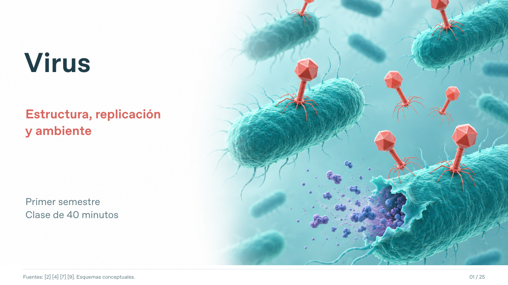

# Virus: estructura, replicación y ambiente

Clase visual para primer semestre de Microbiología, Biología y Ciencias Biomédicas. **40 minutos en total, incluida una actividad de 6 minutos.**

- [Descargar PowerPoint editable](https://github.com/espinemilia02-design/Clases2026/raw/refs/heads/main/virus_ecuador_40min/Virus_Ecuador_40min.pptx)
- [Ver presentación PDF](Virus_Ecuador_40min.pdf)
- [Guía docente y resúmenes de artículos](Guia_docente_Virus_40min.md)
- [Ficha de actividad: tres casos, 6 minutos](Ficha_actividad_Virus_6min.pdf)

20 diapositivas de clase y 5 de bibliografía. Incluye estructura y composición, dependencia del metabolismo celular, ciclos lítico y lisogénico, gemación, regulación de poblaciones y materia celular liberada por lisis. Explica por qué se consideran entidades acelulares y distingue los rasgos observables del debate sobre la definición de vida.

Cuatro tablas comparativas y la gráfica de actividad frente a cepas de E. coli son editables. Los rótulos se pueden editar. Las ilustraciones científicas se integran como imágenes.

Tres estudios realizados en Ecuador: BME3 de Estero Salado (2025), fagos frente a Salmonella Infantis (2026) y ARN de SARS-CoV-2 en ríos de Quito (2020). La guía explica qué resultados sustentan las aplicaciones y qué pruebas adicionales se requieren. Las fuentes recientes sobre ecología y metabolismo se distinguen de los antecedentes históricos compartidos por la docente.

La actividad distribuye un caso por equipo. Un minuto de lectura, tres de discusión y dos de puesta en común. Elijan dos preguntas de su ficha. La guía contiene respuestas orientadoras.

Las figuras son ilustraciones conceptuales originales generadas con asistencia de IA. No son micrografías, imágenes de los sitios de muestreo ni resultados experimentales. No comparten escala. La guía incluye fuentes y alcance de uso. Consulta bibliográfica: 2 de noviembre de 2026.
